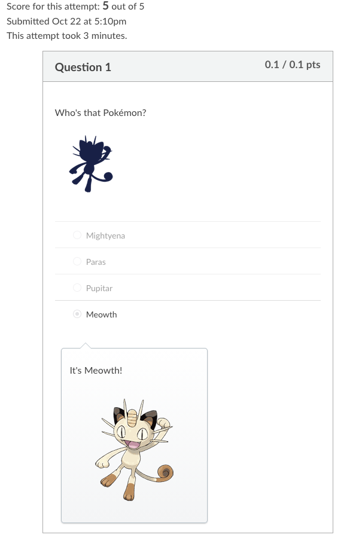

# Canvas test courses for LTI development

A **theme-agnostic generator** that builds a feature-dense Canvas course as a Canvas Course Export Package (`.imscc`), plus a **REST seeder** that adds everything a cartridge can't carry: sections, users, groups, overrides, submissions and grades.

The content is inert filler supplied by a **theme** (`themes/<name>/`). The point is coverage: every content type, submission type, grading type and quiz question type, plus module rules, date and time-zone edge cases, and awkward content (unicode, RTL, escaping, 255-character titles, a 386-row page). LTI tools usually break on these. Every theme exercises the **same test matrix**; see **[docs/test-matrix/public-domain.md](docs/test-matrix/public-domain.md)** (or [docs/TEST_MATRIX.md](docs/TEST_MATRIX.md) for Pokémon) for what each item tests.

There are two themes:

| Theme | Build | Use |
|---|---|---|
| **`public-domain`** (default): "Public Domain Academy", a course about public-domain law | `uv run cc build` → `dist/public-domain-academy.imscc` | **Safe for commercial use.** CC0 museum images, public-domain media, original text and art. See `themes/public-domain/PROVENANCE.md`. |
| **`pokemon`**: "Pokémon Trainer Academy: Gen I–III" | `uv run cc build -p` (or `-P` / `--pokemon`) → `dist/pokemon-trainer-academy.imscc` | Internal, non-commercial use only (see Notes). |

```bash
uv sync --extra dev
uv run cc themes                     # list themes and their shortcut flags
uv run cc build                      # default theme -> dist/public-domain-academy.imscc (+ validation)
uv run cc build -p                   # Pokémon theme -> dist/pokemon-trainer-academy.imscc
uv run cc build --images generated   # offline: never fetch images
uv run pytest                        # contract + integrity tests, run for every theme
```

Import it manually: **Course → Settings → Import Course Content → "Canvas Course Export Package"**. Tick *"Import existing quizzes as New Quizzes"* if you want New Quizzes. Or let the seeder do the import:

```bash
cp seeder/config.example.toml seeder/config.toml   # sandbox/beta instance only
export CANVAS_TOKEN=...                              # admin token (+ "Become other users" for activity)
uv run cc seed                 # create course, import, seed people & activity -> dist/seed-manifest-<theme>.json
uv run cc seed --new-quizzes   # same, but convert Classic quizzes to New Quizzes on import
uv run cc verify               # assert live counts match the theme's content
uv run cc teardown             # delete the course and the theme's <sis_prefix>-* users (public-domain: pda-*, pokemon: pta-*)
```

All three take `--theme` or `-p` (or `theme = "..."` in `config.toml`). `dist/seed-manifest-<theme>.json` records every Canvas id: course, sections, users and their roles, assignments, quizzes, pages, modules and groups. Point your LTI test suite at it.

---

## Why a generated `.imscc`

We compared two example exports:

| | `.zip` example | `.imscc` example |
|---|---|---|
| What it is | Canvas's **offline HTML viewer** ("Download Course Content"): `index.html` + `viewer/bundle.js` + `course-data.js` | **Canvas Course Export Package**: Common Cartridge 1.1 + Canvas `cccv1p0` extensions |
| Re-importable | No (read-only, lossy) | Yes (`canvas_cartridge_importer`, highest fidelity) |

The generator emits exactly what `canvas-lms/lib/cc/*.rb` emits:
- `imsmanifest.xml`
- `course_settings/*` (course settings, module meta, assignment groups, grading standards, rubrics, outcomes, files meta, events, late policy, syllabus, plus the `canvas_export.txt` marker that makes Canvas treat the package as Canvas-flavored)
- `<id>/assignment_settings.xml`
- `wiki_content/*.html` with `<meta>` tags
- discussion `topic` + `topicMeta`
- Classic Quiz QTI: a CC-profile copy, the full-fidelity `non_cc_assessments/*.xml.qti`, and `assessment_meta.xml`
- question banks, web links, LTI tool links and `web_resources/` files

Cross-links use Canvas's export placeholders: `$WIKI_REFERENCE$`, `$CANVAS_OBJECT_REFERENCE$`, `$CANVAS_COURSE_REFERENCE$` and `$IMS-CC-FILEBASE$`.

**Stable identifiers.** Every object's migration id is `md5(namespace:kind:key)`, where the namespace comes from the theme (`pda` for public-domain, `pta` for pokemon). Re-importing a rebuilt package into the same course **updates objects in place** instead of duplicating them, and two different themes never collide.

## Themes

A theme is a directory under `themes/` with `theme.yaml` (namespace, catalog, image source, identify-question strings, seeder keys), optional `theme.py` hooks (placeholder art, file recipes, extra template helpers), the content (`course.yaml`, `modules/`, `pages/`, `quizzes/`, `data/`, `files/`), `lti.example.yaml` and the seeder's `roster.yaml`. All Canvas mechanics live in `cc_gen/` and are shared.

```bash
uv run cc matrix --theme NEW --compare pokemon --ignore-tests   # prove a theme has the same test matrix
uv run cc validate --theme NEW --forbid-theme pokemon           # prove no Pokémon names/brands leaked in
```

`--compare` diffs a theme-independent *signature* of both courses (every Canvas setting, requirement, date spec, quiz setting and question shape, with titles, text, keys and URLs removed). The test suite runs it automatically for every theme, and runs the `--forbid-theme` check for every theme marked `commercial: true`. A theme can claim CLI shortcut flags with theme.yaml `cli_flags` (Pokémon: `-p`, `-P`, `--pokemon`). **CLAUDE.md** is the full guide to creating a theme.

## Public Domain Academy theme: sources

- **Curriculum:** Orientation → Unit 1 *Copyright Foundations* → Unit 2 *How Works Enter the Public Domain* → Unit 3 *Using the Public Domain* (edge cases and global terms), plus the LTI, preview and empty modules. Every setting mirrors the Pokémon theme item for item. Course text includes a "not legal advice" disclaimer.
- **Catalog:** 386 public-domain artworks (151 before 1800, 100 from the 1800s, 135 from 1900–1930) from the **Art Institute of Chicago** and **The Metropolitan Museum of Art** open-access APIs, both CC0.
  - `data/collection.csv` records each work's source record, image URL, licence, PD flag and retrieval date. `data/provenance.jsonl` keeps the CC0 API fields as evidence.
  - Both are produced once by `themes/public-domain/tools/curate_catalog.py`; the build only reads the CSV.
  - Images are fetched at build time (cached in `build/cache/pd-open-access/`), downscaled to 256px (above the largest display size, 215px) and palette-compressed. The package is ~7.9 MB with real images.
  - Quiz images ("Name That Work!") are pixelated versions.
- **Media:** an 8-second excerpt of Edison's *Kinetoscopic Record of a Sneeze* (1894, Library of Congress) and a 6-second excerpt of *The Stars and Stripes Forever* by the U.S. Marine Band (a U.S. government work). Captions are original.
- **Everything else** (banners, status badges, placeholder labels, PDFs, DOCX, CSV/JSON/.py) is generated by `theme.py`. The annotatable PDF quotes the Copyright Clause and Title 17, which are U.S. government works.
- **Roster:** fictional characters from public-domain literature, avoiding characters with live trademark claims.

## Pokémon theme: artwork



Each build tries to fetch the official Pokédex image for all 386 species from `https://www.pokemon.com/static-assets/content-assets/cms2/img/pokedex/detail/NNN.png` (theme.yaml `images.source`):
- Downloads are validated as PNGs and cached in `build/cache/pokemon-com/` (gitignored). After the first build, art is available offline and rebuilds are byte-identical.
- Any species that can't be fetched (no internet, HTTP error, bad image) falls back to its generated placeholder card, one species at a time. When offline, a single failed probe skips the rest, so the build doesn't wait out 386 timeouts.
- Alt text says which kind each image is ("Official artwork for #001 Bulbasaur" or "Placeholder card for …").
- Quiz images ("Who's that Pokémon?") are silhouettes made from the official art:
  - **Transparent background** (all 386 as of 2026-10-21): the PNG's own alpha channel is the mask. Edges stay anti-aliased, holes like the inside of Mew's tail loop stay open, and opaque white on the Pokémon (Togepi's shell) stays solid.
  - **Fallback, if the images ever ship on opaque white:** a flood fill from the image border treats border-connected near-white as background. Enclosed background (Mew's loop) gets filled in this mode.
  - Offline, quizzes use name-hidden cards instead.
- `--images auto` (default) / `required` (fail the build if any can't be fetched; `official` still works) / `generated` (never fetch). `--refresh-images` ignores the cache. The old `--sprites` / `--refresh-sprites` spellings still work.
- **Compression** (default `--art-quality palette`):
  - Official art, fallback cards and type badges are written as 256-color palette PNGs. That's about 79% smaller, with a visible error of about 3/255 against the originals.
  - Silhouettes are single-color palette PNGs with 16 alpha levels for the soft edges (~1.8 KB each).
  - `--art-quality original` ships the untouched pokemon.com files.
  - The cache always holds the originals, so switching needs no re-download.
  - The package is ~4.1 MB with official art (13.9 MB with `original`).

## Builds

**Randomized content.** Some content is picked at random on each build: the first three "Who's That Pokémon?" questions, and the wrong-answer names in its 386-question bank. The build prints the seed it used; `cc build --seed N` reproduces that build byte-for-byte. Separately, Canvas re-draws the quiz's last three questions from the bank on every attempt.

**Relative dates.** Content never hard-codes dates. Specs like `"+7d@23:59"`, `"-2d"` or `"dst_next@01:30"` resolve against `--anchor` (default: today) in the course time zone. That means a fresh build always has items that are past due, due today, due this week, due on the next DST change, and so on. Builds are byte-for-byte reproducible for a given anchor and `--seed`.

## What's inside (summary)

| Area | Coverage |
|---|---|
| Modules | Prerequisites, sequential progress, future `unlock_at`, unpublished module, empty module, sub-headers, indents, `new_tab`. Completion requirements: must_view, must_submit, must_contribute, must_mark_done, min_score |
| Pages | Front page, unpublished, scheduled `publish_at`, `todo_date`, student-editable, orphan (not in a module), kitchen-sink RCE content, 386-row page, 30-image page, RTL / CJK / emoji / escaping / 255-char titles |
| Assignments | Every submission type (text, URL, upload with extension limits, media, student annotation, on paper, none, multiple types at once, external tool) and every grading type (points, percent, letter, GPA, pass/fail, not graded). Also: extra credit, group (graded per group or individually), peer review (auto + anonymous), moderated, anonymous grading, manual post policy, `allowed_attempts`, `omit_from_final_grade`, `only_visible_to_overrides`, rubrics, plus 9 date edge cases |
| Quizzes (Classic QTI) | All 12 question types; 9 quizzes, 7 of which draw from the 386-question "Who's That Pokémon?" silhouette bank. Three are made only of bank draws: Lightning Round (10 questions, 3-min limit, keep_average, results hidden until the last attempt, min_percentage requirement), Marathon (50 questions, extra credit, keep_latest, one-time results) and an unpublished quiz (results always hidden). Also: question groups (bank + inline), practice quiz, graded and anonymous surveys, attempts, one-question-at-a-time / can't-go-back, access code, show-answers windows |
| Discussions | Threaded, flat, side-comment, graded with rubric, require initial post, ratings, pinned, locked, group discussion, `todo_date`. Announcements: posted, delayed, locked |
| Course | Weighted groups with drop rules, 3 grading schemes, late policy, 4 outcomes (each calculation method), 3 rubrics, recurring / all-day / multi-day / DST-spanning events, custom tab order and hidden tabs, course image + banner |
| Files | ~800 course files per theme: nested folders, hidden + locked folder, locked / hidden / lock-dated files, usage rights, display-name ≠ filename, unicode filename, PDF / DOCX / CSV (10k rows) / JSON / .py / PNG / GIF / WebP / SVG / MP4 / MP3 / VTT |
| LTI (opt-in) | Copy `themes/<theme>/lti.example.yaml` → `themes/<theme>/lti.yaml` to add an "LTI Sandbox" module: course-level tool (1.1 or 1.3 by `client_id`) with placements, course nav tab, inline + new-tab module launches, `external_tool` assignments with an AGS line item, RCE iframe embed via `/external_tools/retrieve` |
| Seeder | 3 sections (one with its own dates), teacher / section-limited TA / designer / second teacher / observer, 12 students (multi-section, inactive, concluded, unicode, very long name), filled and self-signup group sets, section / student / group overrides, module progress, discussion posts, text / URL / file submissions, grades in every grading type, rubric assessments, an excused submission, a hidden grade, a final grader, optional LTI 1.3 tool install |

## Repo layout

```
themes/public-domain/      # the default (commercial-safe) theme; same layout as below, plus PROVENANCE.md and tools/curate_catalog.py
themes/pokemon/            # a theme: SOURCE OF TRUTH for its content
  theme.yaml               # namespace, catalog, images, identify strings, seeder keys, brand terms
  theme.py                 # hooks: placeholder cards, type badges, PDFs/CSV/JSON recipes, type helpers
  course.yaml              # settings, tabs, groups, schemes, outcomes, rubrics, events, announcements, file metadata
  modules/NN-*.yaml        # one file per module; items define pages/assignments/discussions inline
  pages/*.html             # Jinja-templated RCE HTML
  quizzes/*.yaml           # one quiz or question bank per file
  data/pokedex_1_386.csv   # the catalog (PokeAPI CSVs, Gen III-era typings)
  files/                   # static course files copied as-is (media clips + captions)
  lti.example.yaml         # optional LTI tool config template
  roster.yaml              # seeder people/sections/groups/overrides/activity
cc_gen/                    # theme-agnostic generator: theme.py, content.py, writers/*, assets.py, images.py, validate.py, matrix.py, cli.py
seeder/                    # seed.py, canvas_api.py, config.example.toml
docs/TEST_MATRIX.md        # pokemon matrix, generated by `cc matrix -p` (other themes: docs/test-matrix/<theme>.md)
tests/                     # pytest: test_contract.py runs for every theme
```

## Authoring reference

**Module item types** (`modules/*.yaml` → `items:`):
- `subheader`, `page`, `assignment`, `discussion`: defined inline with a unique `key`.
- `quiz`: references `quizzes/<key>.yaml`.
- `file`: `path:` is the course-files path.
- `url`: `key`, `url`, `new_tab`.
- `external_tool`: `tool:` is a key in `lti.yaml`.

**Common item fields:**
- `indent`
- `requirement` (must_view / must_submit / must_contribute / must_mark_done / min_score + `min_score`)
- `item_published`
- `tests: [...]` feeds the test matrix

To reuse an object in a second module, set `ref: true`.

**HTML helpers** (in pages, descriptions, messages and question text):
- `{{ a_page('key') }}`, `{{ a_assignment('key') }}`, `{{ a_quiz('key') }}`, `{{ a_discussion('key') }}`, `{{ a_file('path') }}` emit anchor tags. The bare `page()` / `assignment()` / `quiz()` / `discussion()` / `file()` return the URL only.
- `{{ module_item('module-key', 'page-<key>') }}`, `{{ course_link('grades') }}`
- `{{ img(path, alt) }}`, `{{ entry_image(entry('Pikachu')) }}`, `{{ masked(entry('Pikachu')) }}` (masked image, name-free alt and filename)
- `{{ date('+3d@17:00') }}`, plus `catalog`, `catalog_group(n)`, `fetched_count()`, `settings`, `lti` and `course`
- Theme helpers from `theme.py` `jinja_globals` (public-domain: `{{ status_badge('cc0') }}`, `pd_year(death, term)`, `TERMS`, `DEATH_YEARS`; pokemon: `{{ type_badge('Fire') }}`, `TYPES`, `TYPE_COLORS`, `effectiveness(a, d)`)

Every reference is checked at build time. A dangling link fails the build.

**Question types** (`quizzes/*.yaml` → `questions:`):

| `type` | Fields |
|---|---|
| `multiple_choice`, `multiple_answers` | `answers: [{text, correct, feedback}]` |
| `true_false` | `answer: true\|false` |
| `short_answer` | `answers: [accepted, ...]` |
| `fill_in_multiple_blanks` | text has `[blank]`; `blanks: {blank: [accepted, ...]}` |
| `multiple_dropdowns` | `blanks: {blank: {correct, options: [...]}}` |
| `matching` | `pairs: [{left, right}]`, `distractors: [...]` |
| `numerical` | `answers: [{exact, margin} \| {range: [lo, hi]} \| {approximate, precision}]` |
| `calculated` | text has `[var]`; `formula`, `variables: [{name, min, max, scale}]`, `tolerance`, `decimal_places`, `sets` |
| `essay`, `file_upload`, `text_only` | text only |
| `group` | `name`, `pick`, `points_per_item`, and either `bank: <bank-key>` or `questions: [...]` |

Every question also takes `name`, `points`, `text` and `feedback: {correct, incorrect, neutral}`. Banks are quiz files with `bank: true`.

**Generated identify questions:** `{type: generated, generator: identify, count: 3, catalog_group: 1}` (or `all: true`) expands into multiple-choice "who is this?" questions, one per picked catalog entry: the masked image plus 4 names, with prompt and feedback strings from theme.yaml `identify`.

**Masked-image questions get their answer as feedback.** Any question whose text shows a masked image via `{{ masked(...) }}` automatically gets *general* (neutral) feedback showing the unmasked image of the same entry, as HTML. Students see it after answering, right or wrong. An explicit `feedback.neutral` overrides it. Feedback strings are Jinja-rendered, so they can use the same helpers as question text.

## Validation & data hygiene

`cc build` runs `cc validate` automatically. It checks:
- XML is well-formed, and Canvas documents pass the `cccv1p0.xsd` schema.
- Manifest integrity: hrefs, ids and dependencies.
- Organization and module_meta references resolve.
- Every placeholder link resolves, and no file is left unreferenced.

A handful of elements that Canvas's own exporter writes (`category`, `points_based`, `late_policy`, topic `locked`) are missing from Canvas's published XSD. These are reported as a note, not an error; real Canvas exports fail the XSD the same way.

```bash
uv run cc validate --hygiene-against path/to/some-client-export.imscc
```

This extracts distinctive strings (titles, domains, identifiers) from a reference export and fails if any appear in the package. Use it to prove that no client content leaked into the fixture. The `examples/` folder is gitignored and must never be committed.

## Verify on your first import

These behaviors depend on instance configuration or are thinly documented. Check them once per instance:
- **Student annotation**: needs DocViewer. The annotatable PDF is linked by `annotatable_attachment_migration_id`.
- **Media**: MP4 / MP3 / VTT ship as plain course files with HTML5 `<video>`/`<track>`. The cartridge can't create Canvas media objects, so the captions are not Canvas "media tracks".
- **Recurring events**: emitted as a 6-event series (`rrule` + `series_uuid`), exactly as Canvas exports them.
- **New Quizzes**: with `--new-quizzes`, practice quizzes and surveys convert to New Quizzes types. Formula and other complex questions convert as well as Canvas's converter allows, so check the migration issues list.
- **LTI 1.3 tools**: the developer key (`client_id`) must already exist and be enabled. If it doesn't, the import reports an error for that tool.
- **Not included on purpose**:
  - Mastery Paths, discussion checkpoints and course pacing. These depend on feature flags, and their export format isn't documented well enough to generate blind. To add one, build it by hand once, export, and copy the shape.
  - Blueprint settings and collaborations/conferences, which aren't importable.

## Notes

- Pokémon theme: Pokédex images are official pokemon.com artwork when fetched; everything else (banners, type badges, fallback cards) is an original generated placeholder.
- Pokémon names and facts are used as filler for internal, non-commercial testing. Pokémon is a trademark of Nintendo / Creatures / GAME FREAK. For anything commercial, use the default `public-domain` theme (`commercial: true`, built only from public-domain/CC0 material).
- `cc_gen/xsd/cccv1p0.xsd` is vendored from [instructure/canvas-lms](https://github.com/instructure/canvas-lms) (AGPL-3.0) for validation only.
